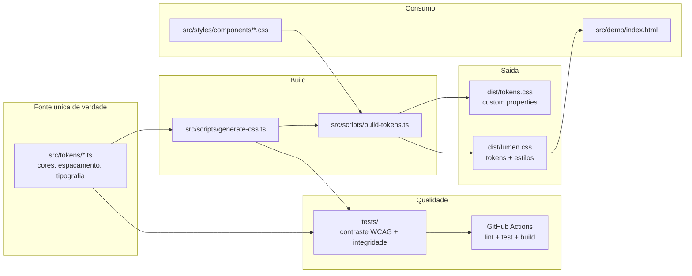

# lumen-ds

[](https://github.com/Vitto-code/lumen-ds/actions/workflows/ci.yml)
[](https://github.com/Vitto-code/lumen-ds)
[](https://github.com/Vitto-code/lumen-ds)

Design system em CSS puro que resolve a inconsistencia visual e a manutencao cara de estilos: uma unica fonte de verdade em TypeScript gera todos os tokens como CSS custom properties, com dark mode, componentes acessiveis e contraste WCAG garantido por testes automatizados.

## Demonstracao

A pagina de demo (`src/demo/index.html`) mostra todos os componentes (botoes, badges, formularios, alertas e cards) em um unico lugar. Um botao "Alternar tema" troca entre claro e escuro sem recarregar a pagina, persistindo a escolha em `localStorage`; sem escolha explicita, o tema segue o `prefers-color-scheme` do sistema operacional. Para ver em movimento:

```bash
npm install && npm run build
docker compose up demo
# abra http://localhost:8080
```

Sem Docker, basta abrir `src/demo/index.html` no navegador apos o build.

## Arquitetura



## Decisoes tecnicas

- **CSS puro em vez de Sass ou Tailwind.** O objetivo era dominar a plataforma sem dependencia de runtime ou preprocessador: custom properties nativas ja cobrem tokens e temas. O custo e nao ter mixins nem nesting (ainda inconsistente entre navegadores); o ganho e zero etapa de compilacao para quem consome o CSS e nenhuma dependencia de producao.
- **Tokens em TypeScript como fonte unica.** Cores, espacamentos e tipografia vivem em `src/tokens/` e o CSS e gerado. Isso torna impossivel um componente usar uma cor fora da paleta sem que ninguem perceba, e permite testar os tokens como codigo (contraste, monotonicidade de escala). O trade-off e um passo de build a mais, mitigado por `npm run build` levar menos de um segundo.
- **Dark mode sem JavaScript obrigatorio.** A media query `prefers-color-scheme` cobre o caso padrao e `[data-theme='dark']` permite sobreposicao manual. JavaScript so entra para persistir a escolha do usuario. Consequencia: o CSS gerado declara o tema escuro duas vezes (media query + atributo), alguns bytes a mais em troca de funcionar com JS desabilitado.
- **Contraste WCAG testado, nao revisado no olho.** `tests/contrast.test.ts` calcula a razao de contraste de cada par texto/fundo dos dois temas e exige AA (4.5:1 para texto, 3:1 para foco). Qualquer mudanca de cor que quebre acessibilidade falha no CI.
- **Concatenacao simples em vez de bundler.** O build junta os arquivos em ordem de cascata definida em `STYLE_ORDER`. Para um design system desse tamanho, um bundler (PostCSS, Lightning CSS) seria complexidade sem beneficio; se o projeto crescer para dezenas de componentes, essa e a primeira coisa que eu revisitaria.

Mais detalhes em [docs/decisions.md](docs/decisions.md).

## Como rodar

Pre-requisitos: Node.js 20+ e, opcionalmente, Docker.

```bash
git clone https://github.com/Vitto-code/lumen-ds.git
cd lumen-ds
npm install        # ou: make setup
npm run build      # gera dist/tokens.css e dist/lumen.css
docker compose up demo   # ou: make run -> http://localhost:8080
```

Tempo total: menos de 5 minutos. Sem Docker, abra `src/demo/index.html` no navegador depois do build.

Para usar o design system em outro projeto, copie `dist/lumen.css` e referencie no HTML:

```html
<link rel="stylesheet" href="lumen.css" />
<button class="lumen-btn lumen-btn--primary">Salvar</button>
```

## Como testar

```bash
npm test               # testes unitarios
npm run test:coverage  # com relatorio de cobertura (limiar de 70%)
npm run lint           # stylelint + verificacao de tipos
```

Verificacao manual do container da demo:

```bash
curl -I http://localhost:8080          # esperado: HTTP/1.1 200 OK
curl -s http://localhost:8080/dist/tokens.css | head -5   # custom properties geradas
```

Exemplo rapido de componente com estado de erro acessivel:

```html
<div class="lumen-field">
  <label class="lumen-label" for="email">E-mail</label>
  <input class="lumen-input" id="email" aria-invalid="true" aria-describedby="erro" />
  <span class="lumen-error" id="erro" role="alert">Informe um e-mail valido.</span>
</div>
```

## O que aprendi

- **CSS custom properties como API publica**: tokens versionados e nomeados por funcao (semantica) e nao por valor (cor) em [src/tokens/colors.ts](src/tokens/colors.ts).
- **Cascata de temas sem JavaScript**: combinacao de `prefers-color-scheme` e seletor de atributo em [src/scripts/generate-css.ts](src/scripts/generate-css.ts).
- **Contraste WCAG programatico**: luminancia relativa e razao de contraste implementadas do zero em [tests/helpers/contrast.ts](tests/helpers/contrast.ts) e aplicadas a todos os pares de cor em [tests/contrast.test.ts](tests/contrast.test.ts).
- **Geracao de CSS a partir de codigo**: o build em [src/scripts/build-tokens.ts](src/scripts/build-tokens.ts) mostra como manter uma unica fonte de verdade entre design e implementacao.
- **Acessibilidade como propriedade do sistema**: `prefers-reduced-motion`, skip links e foco visivel centralizados em [src/styles/utilities/a11y.css](src/styles/utilities/a11y.css).

## Estrutura

```
src/
  tokens/       fonte unica: cores, espacamento, tipografia (TS)
  scripts/      gerador de custom properties e build do bundle
  styles/       base, utilities e components (CSS puro, sem valores fixos)
  demo/         pagina de demonstracao com toggle de tema
tests/          contraste WCAG, integridade de tokens e saida do build
docs/           architecture.md e decisions.md
```
