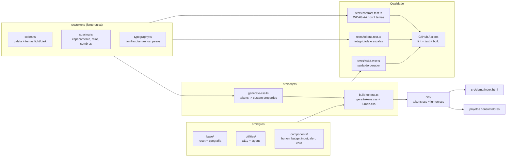
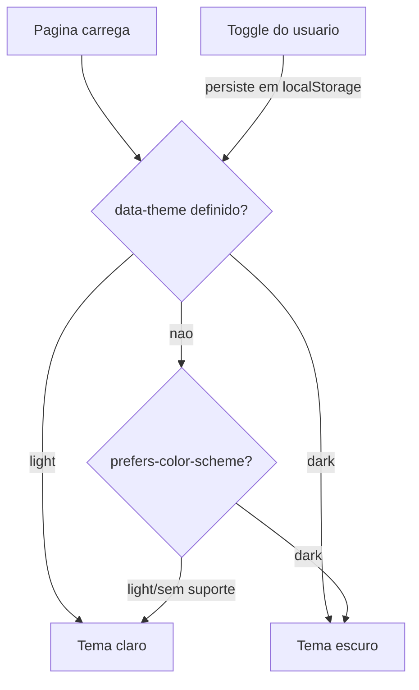

# Arquitetura

## Visao geral

O lumen-ds tem tres camadas: **tokens** (dados em TypeScript), **build** (geracao de CSS) e **estilos** (CSS puro que consome as custom properties geradas). Nada em `src/styles/` contem valores fixos de cor, espacamento ou tipografia.

## Fluxo de dados

1. Uma mudanca de design comeca em `src/tokens/` (ex.: nova cor de destaque).
2. `npm run build` regenera `dist/tokens.css` e `dist/lumen.css`.
3. Componentes refletem a mudanca automaticamente, pois so usam `var(--lumen-*)`.
4. `npm test` valida que o novo valor mantem contraste AA nos dois temas.

## Estrategia de temas

O toggle no demo escreve `data-theme` no `<html>` antes do primeiro paint (script inline no `<head>`), evitando o flash de tema errado (FOUC de tema).

## Decisoes de estrutura

- `src/tokens/` e TypeScript (nao JSON) para ter tipagem, comentarios e derivacao de valores a partir da paleta.
- A ordem de cascata do bundle e explicita em `STYLE_ORDER` em `src/scripts/build-tokens.ts`, nao dependente de ordem alfabetica de arquivos.
- `dist/` e artefato de build: nao versionado, sempre reproduzivel com `npm run build`.
